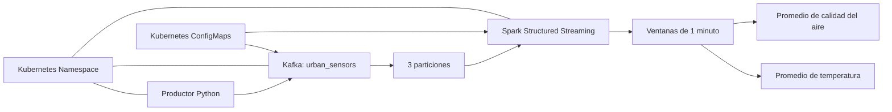


# CoderHouse Data Engineering

## Pre-entrega 1: Infraestructura base en AWS con Terraform

### Objetivo

Implementar una infraestructura base en AWS utilizando Terraform, con una red privada, acceso privado a S3 mediante un Gateway Endpoint y roles IAM para servicios de datos y auditoría.

### Arquitectura implementada

- **VPC:** red virtual del entorno `dev`.
- **Subredes privadas:** dos subredes distribuidas en zonas de disponibilidad.
- **Tabla de rutas:** asociada a las subredes privadas.
- **S3 Gateway Endpoint:** permite el acceso a S3 desde la VPC sin requerir una ruta pública a Internet para ese servicio.
- **Data Service Role:** rol IAM para un servicio de datos, con permisos de lectura y escritura limitados al prefijo configurado en S3.
- **Audit Read-only Role:** rol IAM con permisos de consulta para EC2, IAM y S3.

### Backend remoto de Terraform

El estado se almacena en un bucket S3 con cifrado SSE-S3 (AES-256), versionado y bloqueo de acceso público. Terraform utiliza el bloqueo nativo de S3 mediante `use_lockfile = true`.

- **Región:** `us-east-1`
- **Bucket:** `coderhouse-data-tfstate-662241429835-us-east-1`
- **Clave del estado:** `coderhouse-data-engineering/dev/terraform.tfstate`

### Estructura del proyecto

- `modules/network/`: recursos de red.
- `modules/identity/`: roles y políticas IAM.
- `environments/dev/`: configuración del entorno de desarrollo.
- `PLAN_OUTPUT.md`: salida del plan de Terraform.

### Requisitos

- Terraform 1.6 o superior.
- AWS CLI configurado con credenciales válidas.
- Permisos de AWS para consultar y administrar los recursos definidos.

### Comandos de ejecución

Ejecutar desde `environments/dev/`:

```powershell
terraform init
terraform fmt -recursive
terraform validate
terraform plan
terraform apply
```

Para consultar los outputs:

```powershell
terraform output
```

### Seguridad

No versionar credenciales, archivos de estado de Terraform, archivos `.tfvars` con valores sensibles ni planes binarios. Mantener `.terraform.lock.hcl` versionado.

### Validación

La infraestructura fue aplicada correctamente. La última ejecución de `terraform plan` finalizó con el mensaje:

`No changes. Your infrastructure matches the configuration.`

Esto indica que no se detectaron diferencias entre la configuración y la infraestructura existente.

---

# Pre-entrega 3: Plataforma de Muestreo Urbano en Tiempo Real

## Objetivo

Implementar una plataforma de procesamiento distribuido para recibir datos de sensores urbanos en tiempo real mediante Apache Kafka y procesarlos con Apache Spark Structured Streaming, desplegando los componentes en Kubernetes.

## Arquitectura

La plataforma utiliza los siguientes componentes:

- **Kubernetes:** ejecuta los servicios en el namespace `urban-platform`.
- **Apache Kafka:** recibe los eventos de los sensores en el tópico `urban_sensors`, configurado con tres particiones.
- **Productor Python:** genera lecturas simuladas de cuatro sensores y las envía a Kafka en formato JSON.
- **Apache Spark Structured Streaming:** consume los mensajes de Kafka y calcula promedios de temperatura e índice de calidad del aire por sensor en ventanas de un minuto.
- **ConfigMaps:** centralizan la configuración de Kafka, Spark y los scripts utilizados por los contenedores.

### Diagrama de arquitectura



## Estructura de archivos

- `k8s/namespace.yaml`: crea el namespace de la plataforma.
- `k8s/kafka-config.yaml`: configuración de Kafka.
- `k8s/kafka.yaml`: Deployment y Service de Kafka.
- `k8s/producer-code.yaml`: ConfigMap que contiene el código del productor.
- `k8s/producer.yaml`: Deployment del productor de sensores.
- `k8s/spark-code.yaml`: ConfigMap que contiene el código de Spark.
- `k8s/spark-config.yaml`: configuración del procesamiento de Spark.
- `k8s/spark.yaml`: Deployment de Spark Structured Streaming.
- `producers/producer_sensores.py`: genera y envía las lecturas de los sensores.
- `spark/streaming_job.py`: consume los eventos y realiza las agregaciones.

Los ConfigMaps `producer-code` y `spark-code` contienen los scripts que se montan dentro de los contenedores.

## Requisitos

- Docker Desktop con Kubernetes habilitado.
- `kubectl` instalado y configurado para acceder al clúster.
- Acceso a Internet desde el contenedor de Spark para descargar las dependencias Maven en el primer inicio.

## Despliegue

Ejecutar desde la raíz del repositorio, en PowerShell.

### 1. Crear el namespace

```powershell
kubectl apply -f .\k8s\namespace.yaml
```

### 2. Crear las configuraciones y los ConfigMaps de código

```powershell
kubectl apply -f .\k8s\kafka-config.yaml -f .\k8s\spark-config.yaml -f .\k8s\producer-code.yaml -f .\k8s\spark-code.yaml
```

### 3. Desplegar Kafka

```powershell
kubectl apply -f .\k8s\kafka.yaml
```

### 4. Crear el tópico con tres particiones

Esperar a que Kafka esté disponible antes de ejecutar el comando:

```powershell
kubectl wait --for=condition=available deployment/kafka -n urban-platform --timeout=180s
```

Crear el tópico:

```powershell
kubectl exec -n urban-platform deployment/kafka -- /opt/kafka/bin/kafka-topics.sh --bootstrap-server kafka:9092 --create --topic urban_sensors --partitions 3 --replication-factor 1
```

Este comando se ejecuta una sola vez para crear el tópico. Si ya existe, verificarlo con el comando de descripción incluido más abajo.

### 5. Desplegar el productor y Spark

```powershell
kubectl apply -f .\k8s\producer.yaml
kubectl apply -f .\k8s\spark.yaml
```

### 6. Consultar el estado de los pods

```powershell
kubectl get pods -n urban-platform
```

### 7. Consultar los logs del productor

```powershell
kubectl logs deployment/sensor-producer -n urban-platform --tail=20
```

### 8. Consultar los resultados del procesamiento

```powershell
kubectl logs deployment/spark-streaming -n urban-platform --since=10m
```

### 9. Verificar las particiones del tópico

```powershell
kubectl exec -n urban-platform deployment/kafka -- /opt/kafka/bin/kafka-topics.sh --bootstrap-server kafka:9092 --describe --topic urban_sensors
```

## Esquema de los eventos

Cada mensaje enviado por el productor contiene los siguientes campos:

- `sensor_id`: identificador del sensor.
- `temperature`: temperatura registrada.
- `humidity`: humedad registrada.
- `air_quality_index`: índice de calidad del aire.
- `timestamp`: fecha y hora de la medición.

## Procesamiento de datos

Spark Structured Streaming lee los eventos de Kafka, interpreta el JSON y agrupa los datos por sensor y ventana temporal de un minuto. Para cada grupo calcula:

- Promedio de temperatura (`avg_temperature`).
- Promedio del índice de calidad del aire (`avg_air_quality_index`).

Los resultados se muestran en la consola del contenedor de Spark.

## Evidencia de ejecución

Durante la prueba local se verificó el funcionamiento de los componentes de la plataforma:

- El tópico `urban_sensors` se creó con tres particiones.
- El productor envió mensajes JSON correspondientes a cuatro sensores.
- Los logs de Spark mostraron lotes de procesamiento (`Batch`) con resultados agrupados por sensor y ventana temporal.
- Las columnas de salida incluyeron `window`, `sensor_id`, `avg_temperature` y `avg_air_quality_index`.

### Ejemplo de salida observada

Durante la validación se observaron resultados de agregación por sensor, como los siguientes:

| sensor_id | avg_temperature | avg_air_quality_index |
|---|---:|---:|
| sensor-001 | 31.41 | 161.67 |
| sensor-002 | 29.01 | 47.00 |
| sensor-003 | 26.74 | 99.50 |
| sensor-004 | 23.56 | 113.50 |

Estos valores corresponden a una ejecución de prueba; las mediciones pueden variar porque el productor genera datos simulados.

Para consultar nuevamente los resultados en el clúster:

```powershell
kubectl logs deployment/spark-streaming -n urban-platform --since=10m
```

La evidencia completa de los logs se conserva localmente en `spark-evidence.log` y puede regenerarse durante nuevas pruebas.

## Consideraciones

- Los recursos de esta pre-entrega se despliegan en un clúster Kubernetes local.
- La replicación de Kafka se configura en uno para el entorno de desarrollo.
- El productor genera mediciones simuladas para demostrar el flujo de datos.
- No se incluyen credenciales en los manifiestos ni en los scripts.
